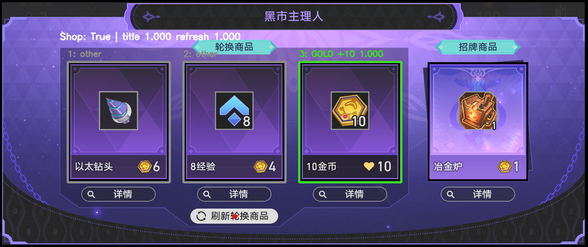

# JadeUnlimited · 翡翠黑市自动识别工具

**基于 OpenCV 的《崩坏：星穹铁道》三星五费翡翠「黑市主理人」自动识别与交易工具。**

打开黑市商店后，程序会识别三个轮换商品栏位，购买「5 金币换 10 小队生命值」和「10 生命值换 10 金币」，处理完本轮可交易的目标后自动刷新。通过屏幕截图和鼠标模拟完成操作，支持生命值边界、成交确认、暂停与紧急停止。

[下载 Windows 版](https://github.com/ngbyspy/JadeUnlimited/releases/latest) · [提交问题](https://github.com/ngbyspy/JadeUnlimited/issues)

## 功能

- **OpenCV 模板匹配**：同时核对商品图标、名称和价格，两个目标商品出现在任意栏位都能识别。
- **自动交易与免费刷新**：先处理可购买目标，再刷新；同时有两类商品时优先卖血，腾出回血空间。
- **资源边界检查**：生命值达到 100 不再回血，生命值 ≤10 不再卖血，金币不足 5 不买回血。
- **成交确认**：商品状态变化并稳定后才更新账本；结果不明确时停止本次会话。
- **前台窗口保护**：只操作所选游戏窗口；失去焦点自动暂停，切回游戏后可继续。
- **F8 暂停/继续，F9 停止**：支持全局按键检测，也可以使用界面按钮。
- **权限检查**：游戏以管理员运行时，提示将助手以相同权限重启。
- **耗时日志**：记录鼠标输入、画面确认、刷新次数和交易结果。

程序通过截图识别商店，不读取游戏内存。启动和点击前会查询进程权限，以判断 Windows 是否允许模拟鼠标输入。

## 识别示例

绿色框表示识别到的目标商品，红点表示刷新按钮的点击位置。

**5 金币 → 10 小队生命值**


**10 生命值 → 10 金币**



示例图片仅保留商店区域，不包含游戏 UID。

## 下载与运行

### Windows EXE

1. 前往 [Releases](https://github.com/ngbyspy/JadeUnlimited/releases/latest)，下载 `JadeUnlimited-v0.1.3-windows-x64.zip`。
2. **完整解压**压缩包，运行其中的 `JadeUnlimited.exe`。需要保留同目录的 `_internal` 文件夹。
3. 更新版本前先关闭旧版，避免两个助手同时监听热键。

EXE 无需安装 Python。

### 从源码运行

需要 **Windows、Python 3.11+**。一键启动脚本使用 Python 3.11，其他版本可按下方命令手动创建环境。

```powershell
git clone https://github.com/ngbyspy/JadeUnlimited.git
cd JadeUnlimited
py -3.11 -m venv .venv
.\.venv\Scripts\python.exe -m pip install -r requirements-lock.txt
.\.venv\Scripts\python.exe main.py
```

也可以双击 `start.bat`，首次运行会自动创建虚拟环境并安装依赖。

## 使用步骤

1. 在游戏中打开三星五费翡翠的「黑市主理人」商店，确保三个轮换商品和刷新按钮可见。建议使用 **16:9 窗口化或无边框窗口**。
2. 启动助手，选择游戏窗口，点击「识别预览（不点击）」，并在 3 秒内切回游戏。
3. 检查预览是否正确标出了目标商品。本轮没有目标时，识别结果为空是正常的。
4. 填写游戏中当前的**生命值和金币**，按需设置目标金币或刷新上限。
5. 点击「开始（等待切回游戏）」，直接切回游戏，程序检测到游戏位于前台后开始运行。
6. 用 **F8** 暂停/继续，**F9** 停止。鼠标移到屏幕角落也会触发紧急停止。

运行中切出游戏会自动暂停。恢复时可按 F8，或在助手中点「暂停/继续」后切回游戏。暂停期间请保持游戏数值不变；需要手动交易时，先停止会话，重新填写实际数值后再开始。

### 管理员权限

如果游戏以管理员身份运行，普通权限的助手会被 Windows 阻止模拟输入。可以：

- 右键 `JadeUnlimited.exe`，选择「以管理员身份运行」；
- 或点击助手左下角「以管理员重启」，确认 Windows 提示后重新填写当前数值。

程序会在开始前检查权限。取消管理员重启时，原窗口会保留。

## 交易规则

| 目标商品 | 允许购买的条件 | 确认成交后的账本变化 |
| --- | --- | --- |
| 5 金币 → 10 小队生命值 | 生命值 <100，且金币 ≥5 | 生命值 `min(100, HP + 10)`，金币 −5 |
| 10 生命值 → 10 金币 | 生命值 >10 | 生命值 −10，金币 +10 |

例如，从 **90 生命值、20 金币**开始：卖血后变为 **80 生命值、30 金币**，再回血后变为 **90 生命值、25 金币**。完成这一卖一买，生命值恢复原值，净增 5 金币。

生命值 ≤10 且金币不足 5 时，无法继续交易，程序停止。达到设置的目标金币或刷新次数上限时也会停止。

## 设置

| 设置 | 默认值 | 说明 |
| --- | --- | --- |
| 初始生命值 | 必填 | 当前实际数值，范围 1～100 |
| 初始金币 | 必填 | 当前实际数值，须 ≥0 |
| 目标金币 | 0 | 达到目标后停止；0 表示不限 |
| 刷新上限 | 500 | 达到次数后停止；0 表示不限 |
| 刷新等待/秒 | 0.08 | 刷新后开始观察画面的最短等待 |
| 购买等待/秒 | 0.15 | 购买后开始观察画面的最短等待 |
| 识别阈值 | 0.88 | 图标、名称/价格及商店定位的匹配阈值 |

等待时间只是最短间隔，程序仍会确认画面变化。动画较慢时可提高相应等待时间。

## 识别与确认方式

1. 匹配商店标题和刷新按钮，确认当前处于目标商店。
2. 在三个商品栏位中，同时匹配目标图标和名称/价格。
3. 点击前重新截图，检查商品、游戏焦点、窗口位置和输入权限。
4. 点击时按下左键约 **40 毫秒**后抬起；鼠标已在目标位置时不再重复移动。
5. 只比较商品图标、名称和价格区域，忽略紫色背景动效。连续两张结果稳定后继续下一步。

刷新需要确认商品内容发生变化，且三个栏位均已显示图标和文本。空白过渡画面不算刷新成功。新画面出现可购买目标时，会先处理目标商品再刷新。

**生命值和金币是内部推算账本，并非实时 OCR 读数。** 初始数值必须准确，运行中不应手动改变游戏数值。购买后商品应消失或改变为不可匹配状态；如果游戏版本的成交表现发生变化，程序可能停止，需要更新确认规则。

模板来自当前商店截图，支持居中的 16:9 游戏画面和常见分辨率缩放。UI 改版、特殊宽屏布局、遮挡、黑屏截图或确认弹窗都可能影响识别，首次使用应先检查预览。

## 日志与问题排查

本地运行数据位于：

```text
%LOCALAPPDATA%\JadeUnlimited\
├─ preferences.json   # 非资源类设置
├─ logs\              # 会话 JSONL 日志
└─ diagnostics\       # 异常时保存的商店区域截图
```

可以在助手左下角打开日志目录。每次确认结果会记录本轮耗时、鼠标耗时、画面确认耗时和确认帧数。

| 现象 | 处理方法 |
| --- | --- |
| 提示游戏权限高于助手 | 以管理员身份重启助手 |
| 游戏中 F8 未响应 | 使用界面上的开始/继续按钮，再切回游戏 |
| 刷新或购买确认超时 | 查看商店截图，检查是否遮挡、弹窗或布局变化；可增加等待时间 |
| 刷新后恰好出现完全相同的商品 | 可能无法确认变化，程序会停止，核对数值后重新开始 |
| 运行中手动交易过 | 停止当前会话，重新填写实际生命值和金币 |

提交 Issue 时可附上复现步骤、版本、游戏分辨率及相关日志片段。请先检查附件，移除不希望公开的信息。

## 开发与验证

```powershell
# 离线测试，不发送真实鼠标或键盘输入
.\.venv\Scripts\python.exe -m unittest discover -s tests -v

# 分析本地示例并输出标注图片
.\.venv\Scripts\python.exe main.py --analyze tests\fixtures\health.png --output tests\artifacts\health.png
.\.venv\Scripts\python.exe main.py --analyze tests\fixtures\gold.png --output tests\artifacts\gold.png

# 使用假桌面回放测速，不操作游戏
.\.venv\Scripts\python.exe tools\benchmark_loop.py

# 构建 Windows EXE
powershell -ExecutionPolicy Bypass -File .\build.ps1 -DistPath dist\v0.1.3
```

构建输出为 `dist\v0.1.3\JadeUnlimited\JadeUnlimited.exe`，分发时需要整个 `JadeUnlimited` 文件夹。

当前包含 47 项离线测试，覆盖资源边界、三个栏位、缩放、错误价格、灰色商品、背景动效、空白过渡、成交确认、输入权限及暂停/停止。离线回放单次刷新约 0.23 秒，实际游戏速度还包含游戏响应、动画和截屏耗时。

## 项目结构

```text
jade_unlimited/
├─ app.py        # Tkinter 界面和会话控制
├─ engine.py     # 刷新、购买、确认及日志
├─ vision.py     # OpenCV 模板识别和内容比较
├─ windows.py    # Windows 窗口、权限、鼠标和热键
├─ model.py      # 生命值/金币账本与交易策略
└─ assets/       # 商店及商品模板
tests/           # 离线测试与商店示例
tools/           # 回放测速
docs/images/     # README 识别示例
```
